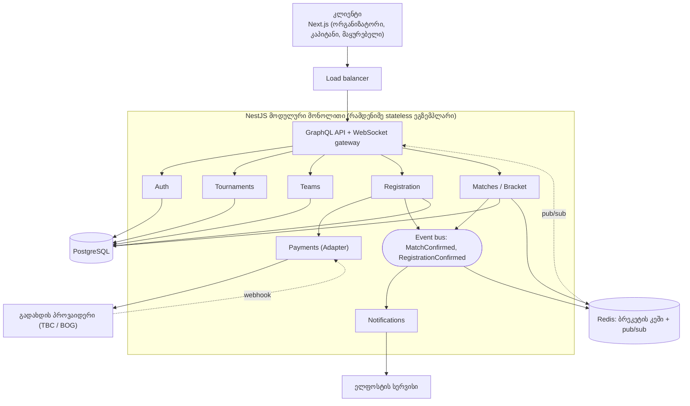

# ArenaLink: არქიტექტურა (პრაქტიკული 2)

> Product Backlog: [README.md](../README.md)

## არქიტექტურული სტილი

ArenaLink-ისთვის ვირჩევ **მოდულურ მონოლითს event-driven ელემენტით** (ცოცხალი განახლებები Redis pub/sub-ით). სცენარი: **D, საკუთარი იდეა** (ლექტორთან შეთანხმება საჭიროა); ის A-ს ახლოსაა, რადგან ტურნირის დღეს დატვირთვა მკვეთრად იზრდება (NFR-02: 500 ერთდროული მაყურებელი ერთ ტურნირზე).

1. **ერთი დეველოპერი, ერთი სემესტრი.** ერთი გასაშვები ერთეული (deploy) მარტივია, მიკროსერვისების მართვა (სერვისების აღმოჩენა, ცალკე CI/CD, ქსელური შეცდომები) მხოლოდ დროს წაიღებდა. მოდულებს (Auth, Tournaments, Teams, Registration, Matches, Payments, Notifications) გარკვეული საზღვრები აქვთ, ამიტომ საჭიროებისას ცალკე სერვისად გამოიტანება.
2. **პიკური დატვირთვა ძირითადად წაკითხვაა.** ტურნირის დღეს ათასობით ადამიანი ბრეკეტს უყურებს, წერა კი ცოტაა. აპლიკაცია stateless-ია, ამიტომ რამდენიმე ეგზემპლარი load balancer-ის უკან მუშაობს, ბრეკეტი Redis-ში იკეშება, WebSocket-ის შეტყობინებები კი pub/sub-ით ყველა ეგზემპლარს ჩაეწოდება.
3. **რეგისტრაცია და გადახდა მკაცრ თანმიმდევრულობას საჭიროებს.** NFR-05 მოითხოვს, რომ 50 პარალელური მოთხოვნიდან ერთ ადგილზე მხოლოდ ერთი გავიდეს. ერთ PostgreSQL ბაზაში ეს ჩვეულებრივი ტრანზაქციითა და ბლოკირებით (`SELECT ... FOR UPDATE`) მოგვარდება, მიკროსერვისებში კი განაწილებულ ტრანზაქციას (saga) მოითხოვდა.

## კომპონენტების დიაგრამა

კლიენტი load balancer-ით ერთ-ერთ ეგზემპლარს უკავშირდება, მოდულები event bus-ით ურთიერთობენ, ბრეკეტი Redis-იდან მოდის, ბაზა კი რეგისტრაციებს, შედეგებსა და ტრანზაქციებს ინახავს.

## Design Pattern-ები

backend-ში ოთხი pattern ბიზნეს-წესებს მონაცემთა წვდომასა და ინტეგრაციებს ჰყოფს, frontend-ში სამი pattern ცოცხალ განახლებებს ამარტივებს.

| ფენა | Pattern | სად გამოიყენება | რატომ |
| --- | --- | --- | --- |
| Backend | Repository | `TournamentRepository`, `TeamRepository`, `MatchRepository` | SQL ბიზნეს-ლოგიკიდან გამოყოფილია, სერვისები ბაზის გარეშე ტესტირდება |
| Backend | Service Layer | `RegistrationService`, `BracketService` | ადგილის დაჯავშნა, გადახდა და ბრეკეტის აგება ერთ ტრანზაქციულ ადგილას ცხოვრობს |
| Backend | Strategy | `BracketGenerator` (`SingleElimination` ახლა, `DoubleElimination` შემდეგ) | US-14-ის დამატება არსებულ კოდს არ ცვლის, მხოლოდ ახალ კლასს ამატებს |
| Backend | Observer (event bus) | მოვლენა `MatchConfirmed` იწვევს ბრეკეტის განახლებას, WebSocket-ის გაგზავნას და კეშის გაუქმებას | მოდულები ერთმანეთს პირდაპირ არ იძახებენ, ახალი რეაქციის დამატება მარტივია |
| Frontend | Custom Hook (ლოგიკის გამოყოფა) | `useBracketLive(tournamentId)`, `useRegistration()` | კომპონენტი მხოლოდ ხატავს, WebSocket-ისა და მოთხოვნების ლოგიკა ერთ ადგილას ინახება |
| Frontend | Observer | WebSocket-ის გამოწერა ბრეკეტის არხზე | მატჩის დადასტურებისას UI გადატვირთვის გარეშე ახლდება (NFR-03) |
| Frontend | Facade | `apiClient` ერთი მოდული ყველა GraphQL გამოძახებისთვის | ენდპოინტის ან სქემის ცვლილება მხოლოდ ერთ ფაილს ეხება |

## API (GraphQL)

API სამი query-ისა და ორი mutation-ისგან შედგება, ვინაიდან ბრეკეტი ბუნებრივად ჩადგმული მონაცემია (ტურნირი → რაუნდები → მატჩები → გუნდები) და ერთი მოთხოვნით იტვირთება.

| ტიპი | ოპერაცია | შესატანი | შედეგი | წვდომა | Story |
| --- | --- | --- | --- | --- | --- |
| Query | `tournaments(status, game)` | სტატუსი და თამაში (არასავალდებულო) | ტურნირების სია | საჯარო | US-02 |
| Query | `bracket(tournamentId)` | ტურნირის ID | რაუნდები, მატჩები, გუნდები და ანგარიში | საჯარო, იკეშება | US-07 |
| Query | `myTeams` | არაფერი (ტოკენიდან) | ჩემი გუნდები და წევრები | ავტორიზებული | US-03 |
| Mutation | `registerTeam(tournamentId, teamId)` | ტურნირი და გუნდი | რეგისტრაცია და გადახდის სესია (ადგილი 10 წუთით ჯავშნდება) | კაპიტანი | US-04 |
| Mutation | `submitMatchResult(matchId, scoreA, scoreB)` | მატჩი და ანგარიში | მატჩი სტატუსით „ელოდება დადასტურებას“ | კაპიტანი | US-06 |

ცოცხალი განახლებისთვის დამატებით არის subscription `bracketUpdated(tournamentId)` (WebSocket), ის 5 ოპერაციაში არ ითვლება (US-08a).

## ბაზა: PostgreSQL (SQL)

ძირითადი ბაზა არის PostgreSQL, რადგან მონაცემები მკაცრად დაკავშირებულია (გუნდი, რეგისტრაცია, გადახდა, მატჩი) და ადგილის დაჯავშნას ტრანზაქცია სჭირდება. NoSQL იქ არ გამოიყენება; Redis მხოლოდ ბრეკეტის კეშისა და pub/sub-ისთვისაა, ამიტომ მასში დაკარგული მონაცემი არაფერს არღვევს.

| ცხრილი | მთავარი ველები | კავშირი |
| --- | --- | --- |
| `users` | `id`, `email` (UNIQUE), `password_hash`, `role` (player / organizer / admin) | |
| `teams` | `id`, `name` (UNIQUE), `captain_id` | `captain_id` → `users` |
| `team_members` | `team_id`, `user_id`, `status` (invited / accepted), PK (`team_id`, `user_id`) | → `teams`, `users` |
| `tournaments` | `id`, `organizer_id`, `name`, `game`, `starts_at`, `max_teams` (CHECK 4, 8, 16 ან 32), `entry_fee`, `status` (draft / open / closed / live / finished) | `organizer_id` → `users` |
| `registrations` | `id`, `tournament_id`, `team_id`, `status` (reserved / confirmed / expired), `reserved_until`, UNIQUE (`tournament_id`, `team_id`) | → `tournaments`, `teams` |
| `payments` | `id`, `registration_id`, `provider_ref`, `amount`, `status` | `registration_id` → `registrations` |
| `matches` | `id`, `tournament_id`, `round`, `position`, `team_a_id`, `team_b_id`, `score_a`, `score_b`, `status` (scheduled / live / awaiting / disputed / done), `next_match_id` | → `tournaments`, `teams`; `next_match_id` → `matches` (გამარჯვებულის გზა) |

**ადგილის დაჯავშნა (NFR-05):** ტრანზაქცია ბლოკავს ტურნირის სტრიქონს (`SELECT ... FOR UPDATE`), ითვლის `reserved` და `confirmed` რეგისტრაციებს და მხოლოდ ლიმიტზე ნაკლების შემთხვევაში ამატებს ახალს. ამიტომ 50 პარალელური მოთხოვნიდან ერთი გადის.

**ინდექსი:** `matches (tournament_id, round)` აჩქარებს `bracket` query-ს (NFR-01), ვადაგასული `reserved` რეგისტრაციები ყოველ წუთს მუშაობს ფონური job-ით და ადგილს ათავისუფლებს.

## ტექნოლოგიური სტეკი და რისკები

სტეკი ერთ ენას (TypeScript) იყენებს frontend-სა და backend-ში, რაც ერთ დეველოპერს კონტექსტის გადართვას ამცირებს.

| ფენა | ტექნოლოგია | რატომ |
| --- | --- | --- |
| Frontend | Next.js (React) + TypeScript | სწრაფი ჩატვირთვა (NFR-01) სერვერული რენდერით, ცნობილი ინსტრუმენტი |
| Backend | NestJS (Node.js) + GraphQL | მოდულური სტრუქტურა და dependency injection მონოლითის მოდულებს ბუნებრივად ერგება |
| ბაზა | PostgreSQL + Prisma | ტრანზაქციები, შეზღუდვები, ტიპიზებული მოთხოვნები |
| კეში და pub/sub | Redis | ბრეკეტის კეში და WebSocket-ის შეტყობინებები რამდენიმე ეგზემპლარს შორის |
| ავტორიზაცია | JWT httpOnly cookie-ში, პაროლები bcrypt-ით | ტოკენი JavaScript-ს არ ეხება |
| გადახდა | პროვაიდერის ტესტ რეჟიმი (მაგ. TBC ან BOG), Adapter-ის უკან | პროვაიდერის შეცვლა ბიზნეს-ლოგიკას არ ეხება |
| ტესტები და CI | Jest, k6 (დატვირთვა), GitHub Actions | შესაბამისობა Definition of Done-თან და NFR-02-ის შემოწმებასთან |

**რისკები:**

| რისკი | რატომ საშიშია | შერბილება |
| --- | --- | --- |
| ტურნირის დღის დატვირთვა | 500 ერთდროული მაყურებელი შეიძლება ბაზასა და WebSocket-ს გადაჭარბებით დაეყრდნოს და ბრეკეტი შეყოვნდეს (NFR-02, NFR-03) | `bracket` იკეშება Redis-ში და ბაზას მხოლოდ ცვლილებისას ეკითხება; k6 ტესტი დაგეგმილ დატვირთვაზე; WebSocket-ის გაწყვეტისას polling-ზე გადასვლა (US-08c) |
| გადახდისა და ადგილის სინქრონიზაცია | გადახდა დასრულდება, მაგრამ webhook დაგვიანდეს ან ორჯერ მოვიდეს; ადგილი დაიკარგოს ან გაორმაგდეს | ადგილი `reserved` სტატუსით 10 წუთით ჯავშნდება, webhook idempotent-ია (`provider_ref` უნიკალურია), ვადაგასული ადგილი job-ით თავისუფლდება |
| ვადა და მოცულობა ერთი დეველოპერისთვის | 66 ქულა დაგეგმილი სამუშაო ერთ სემესტრში შეიძლება ვერ ჩაეტიოს | MVP მხოლოდ Must story-ებია (37 ქულა), Should და Could სპრინტების ბოლოს გადადის, მოდულური მონოლითი ამარტივებს გაშვებას |
