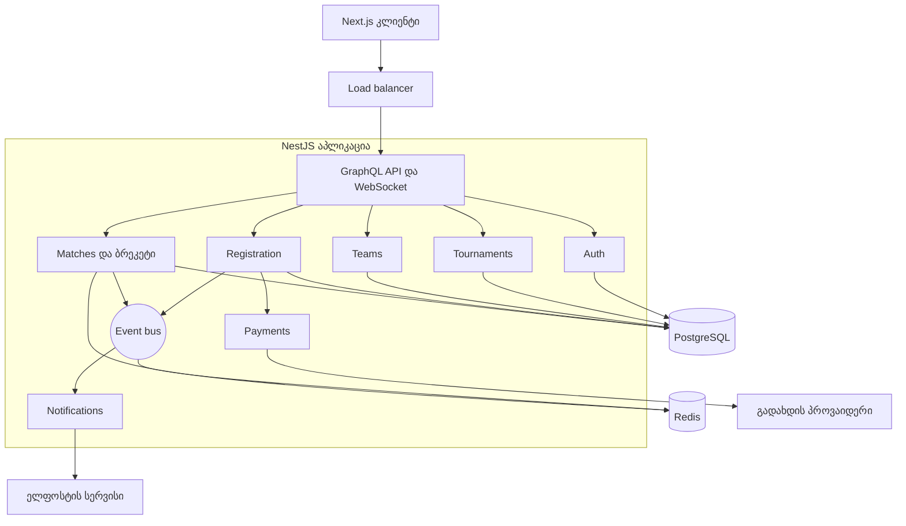

# ArenaLink: არქიტექტურა

Product Backlog: [backlog.md](backlog.md)

## არქიტექტურული სტილი

ArenaLink-ს ვაკეთებ როგორც **მოდულურ მონოლითს**. ეს ერთი აპლიკაციაა, რომელიც შიგნით ცალკე მოდულებად არის დაყოფილი (Auth, Tournaments, Teams, Registration, Matches, Payments, Notifications). მოდულები ერთმანეთს მოვლენებით (event) ესაუბრებიან, ამიტომ არქიტექტურას ნაწილობრივ event-driven ელემენტიც აქვს.

სცენარად ავირჩიე D, საკუთარი იდეა, ამიტომ ლექტორთან შეთანხმება მჭირდება. A სცენარს (დატვირთვა და მასშტაბირება) ისე ჰგავს, რომ ტურნირის დღეს დატვირთვა მკვეთრად იზრდება.

რატომ ეს სტილი:

1. **ერთი დეველოპერი და ერთი სემესტრი.** ერთი აპლიკაცია ერთხელ უნდა გავუშვა და ერთხელ დავაკონფიგურირო. მიკროსერვისებისთვის ცალკე deploy, ცალკე CI და სერვისებს შორის ქსელური შეცდომების დამუშავება დამჭირდებოდა, ეს კი დროს წამართმევდა. მოდულებს ერთმანეთისგან მკაფიო საზღვრები აქვთ, ამიტომ საჭიროების შემთხვევაში მათგან რომელიმე მერე ცალკე სერვისად გამოიტანება.
2. **დატვირთვა ძირითადად წაკითხვაა.** ტურნირის დროს ბრეკეტს ბევრი ადამიანი უყურებს, ჩაწერა კი იშვიათია (შედეგის დადასტურება). ამიტომ ბრეკეტს Redis-ში ვინახავ და ბაზას მხოლოდ ცვლილებისას ვეკითხები. აპლიკაცია არ ინახავს მომხმარებლის მდგომარეობას, ამიტომ საჭიროების შემთხვევაში ორი ეგზემპლარი load balancer-ის უკან გავუშვა, WebSocket-ის შეტყობინებებს კი Redis-ის pub/sub ორივეს გადასცემს.
3. **რეგისტრაცია და გადახდა სიზუსტეს ითხოვს.** ერთ თავისუფალ ადგილზე ორმა გუნდმა ერთდროულად არ უნდა მოახერხოს რეგისტრაცია (NFR-05). როცა ყველაფერი ერთ PostgreSQL ბაზაშია, ამას ჩვეულებრივი ტრანზაქცია და ჩაკეტვა წყვეტს. მიკროსერვისებში ცალკე ბაზებს შორის ამისთვის რთული განაწილებული ტრანზაქცია დამჭირდებოდა.

## კომპონენტების დიაგრამა



კლიენტი მოთხოვნას load balancer-ით აპლიკაციის ერთ-ერთ ეგზემპლარს უგზავნის. API მოთხოვნას შესაბამის მოდულს გადასცემს. მოდულები მონაცემებს PostgreSQL-ში ინახავენ, ბრეკეტი კი Redis-შიც ინახება სწრაფი წაკითხვისთვის. როცა რამე მნიშვნელოვანი ხდება (მაგალითად, შედეგი დასტურდება), მოდული event bus-ში მოვლენას აგზავნის და დანარჩენები საჭიროებისამებრ რეაგირებენ: კეში ახლდება, მაყურებელი WebSocket-ით ახალ ბრეკეტს იღებს, მოთამაშეები კი შეტყობინებას იღებენ.

## Design Pattern-ები

### Backend

- **Repository.** `TournamentRepository`, `TeamRepository`, `MatchRepository`. SQL მოთხოვნები ბიზნეს-ლოგიკისგან ცალკეა, ამიტომ სერვისების ტესტირება ბაზის გარეშეც შეიძლება.
- **Service Layer.** `RegistrationService`, `BracketService`. ბიზნეს-წესები (ადგილის დაჯავშნა, ბრეკეტის აგება) ერთ ადგილას არის და API-ზე დამოკიდებული არ არის.
- **Strategy.** `BracketGenerator` ინტერფეისს ახლა `SingleElimination` ახორციელებს. როცა US-14 (double elimination) დადგება, ახალ კლასს დავამატებ და არსებულ კოდს არ შევცვლი.
- **Observer.** მოდულები ერთმანეთს პირდაპირ არ იძახებენ. მაგალითად, მოვლენა `MatchConfirmed` ბრეკეტს ანახლებს, კეშს აუქმებს და WebSocket-ით მაყურებლებს აცნობებს. ახალი რეაქციის დამატება არსებულ კოდს არ ეხება.

### Frontend

- **Custom Hook.** `useBracketLive(tournamentId)` და `useRegistration()`. კომპონენტი მხოლოდ გამოსახავს, WebSocket-ისა და მოთხოვნების ლოგიკა კი hook-შია.
- **Observer.** ბრეკეტის გვერდი WebSocket-ის არხზე იწერება და ახალი შედეგის მიღებისას გადატვირთვის გარეშე ახლდება (NFR-03).
- **Facade.** ყველა GraphQL მოთხოვნა ერთი `apiClient` მოდულიდან გადის. თუ სქემა შეიცვალა, ცვლილება ერთ ფაილში შემაქვს.

## API

API GraphQL-ია. ავირჩიე იმიტომ, რომ ბრეკეტი ჩადგმული მონაცემია (ტურნირი, რაუნდები, მატჩები, გუნდები) და ერთი მოთხოვნით მთლიანად იტვირთება, ცალკე ბევრი endpoint-ის გარეშე. ძირითადი ხუთი ოპერაცია:

```graphql
type Query {
  # ტურნირების სია, ფილტრით სტატუსსა და თამაშზე (საჯარო, US-02)
  tournaments(status: TournamentStatus, game: String): [Tournament!]!

  # ბრეკეტი მატჩებითა და ანგარიშებით (საჯარო, იკეშება, US-07)
  bracket(tournamentId: ID!): Bracket!

  # ჩემი გუნდები და მათი წევრები (ავტორიზებული, US-03)
  myTeams: [Team!]!
}

type Mutation {
  # გუნდის რეგისტრაცია და გადახდის სესია, ადგილი 10 წუთით ინახება (კაპიტანი, US-04)
  registerTeam(tournamentId: ID!, teamId: ID!): Registration!

  # შედეგის გაგზავნა (კაპიტანი, US-06)
  submitMatchResult(matchId: ID!, scoreA: Int!, scoreB: Int!): Match!
}
```

შედეგის დადასტურებისთვის ცალკე mutation არ მჭირდება. პირველი კაპიტანი ანგარიშს აგზავნის და მატჩი „ელოდება დადასტურებას“ სტატუსში გადადის. თუ მეორე კაპიტანიც იგივე ანგარიშს გამოგზავნის, მატჩი იხურება. თუ სხვა ანგარიშს გამოგზავნის, მატჩი „სადავო“ ხდება.

ცოცხალი განახლებისთვის დამატებით არსებობს subscription `bracketUpdated(tournamentId)` WebSocket-ზე (US-08a). სხვა ოპერაციები, როგორიცაა შესვლა ან ტურნირის შექმნა, ამ ხუთში არ შემიყვანია, მაგრამ აპლიკაციაში ისინიც იქნება.

## ბაზა

ძირითად ბაზად PostgreSQL ავირჩიე (SQL). მონაცემები მჭიდროდ არის ერთმანეთთან დაკავშირებული (გუნდი, რეგისტრაცია, გადახდა, მატჩი), გადახდასთან ერთად კი ტრანზაქციები მჭირდება. NoSQL-ს ვერ დავინახე რაიმე უპირატესობა. Redis ბაზა არ არის, ის მხოლოდ კეშისა და pub/sub-ისთვის მჭირდება, ამიტომ მისი მონაცემების დაკარგვა არაფერს გვიფუჭებს, ბრეკეტი ბაზიდან თავიდან აშენდება.

სქემა (შემოკლებული):

```sql
CREATE TABLE users (
  id            SERIAL PRIMARY KEY,
  email         TEXT UNIQUE NOT NULL,
  password_hash TEXT NOT NULL,
  role          TEXT NOT NULL            -- player, organizer, admin
);

CREATE TABLE teams (
  id         SERIAL PRIMARY KEY,
  name       TEXT UNIQUE NOT NULL,
  captain_id INT NOT NULL REFERENCES users(id)
);

CREATE TABLE team_members (
  team_id INT REFERENCES teams(id),
  user_id INT REFERENCES users(id),
  status  TEXT NOT NULL,                 -- invited, accepted
  PRIMARY KEY (team_id, user_id)
);

CREATE TABLE tournaments (
  id           SERIAL PRIMARY KEY,
  organizer_id INT NOT NULL REFERENCES users(id),
  name         TEXT NOT NULL,
  game         TEXT NOT NULL,
  starts_at    TIMESTAMPTZ NOT NULL,
  max_teams    INT NOT NULL CHECK (max_teams IN (4, 8, 16, 32)),
  entry_fee    NUMERIC(10,2) NOT NULL,
  status       TEXT NOT NULL             -- draft, open, closed, live, finished
);

CREATE TABLE registrations (
  id             SERIAL PRIMARY KEY,
  tournament_id  INT NOT NULL REFERENCES tournaments(id),
  team_id        INT NOT NULL REFERENCES teams(id),
  status         TEXT NOT NULL,          -- reserved, confirmed, expired
  reserved_until TIMESTAMPTZ,
  UNIQUE (tournament_id, team_id)
);

CREATE TABLE payments (
  id              SERIAL PRIMARY KEY,
  registration_id INT NOT NULL REFERENCES registrations(id),
  provider_ref    TEXT UNIQUE NOT NULL,
  amount          NUMERIC(10,2) NOT NULL,
  status          TEXT NOT NULL
);

CREATE TABLE matches (
  id            SERIAL PRIMARY KEY,
  tournament_id INT NOT NULL REFERENCES tournaments(id),
  round         INT NOT NULL,
  position      INT NOT NULL,
  team_a_id     INT REFERENCES teams(id),
  team_b_id     INT REFERENCES teams(id),
  score_a       INT,
  score_b       INT,
  status        TEXT NOT NULL,           -- scheduled, live, awaiting, disputed, done
  next_match_id INT REFERENCES matches(id)  -- სად გადადის გამარჯვებული
);

CREATE INDEX ON matches (tournament_id, round);
```

ადგილის დაჯავშნა (NFR-05) ერთ ტრანზაქციაშია: ჯერ ტურნირის სტრიქონს ვკეტავ (`SELECT ... FOR UPDATE`), მერე ვითვლი `reserved` და `confirmed` რეგისტრაციებს და თუ ლიმიტს არ მივაღწიეთ, ახალ რეგისტრაციას ვამატებ. ამიტომ 50 ერთდროული მოთხოვნიდან მხოლოდ ერთი გადის. ვადაგასულ `reserved` რეგისტრაციებს ფონური job ყოველ წუთში ათავისუფლებს. ინდექსი `(tournament_id, round)` `bracket` query-ს აჩქარებს (NFR-01).

## ტექნოლოგიები

Frontend და backend ორივე TypeScript-ზეა, რომ ერთ ენაზე ვიმუშაო და ერთი დეველოპერისთვის კონტექსტის გადართვა ნაკლები იყოს.

- **Frontend:** Next.js (React) და TypeScript. სერვერული რენდერინგი ბრეკეტის გვერდის სწრაფ ჩატვირთვას (NFR-01) ეხმარება.
- **Backend:** NestJS და GraphQL. მისი მოდულური სტრუქტურა და dependency injection მოდულურ მონოლითს კარგად ერგება.
- **ბაზა:** PostgreSQL და Prisma (ტრანზაქციები, შეზღუდვები და ტიპიზებული მოთხოვნები).
- **კეში და pub/sub:** Redis.
- **ავტორიზაცია:** JWT httpOnly cookie-ში, რომ ტოკენს JavaScript-ი ვერ წვდებოდეს. პაროლები bcrypt-ით ინახება.
- **გადახდა:** პროვაიდერის (TBC ან BOG) სატესტო რეჟიმი, მაგრამ adapter-ის უკან, რომ პროვაიდერის შეცვლა ბიზნეს-ლოგიკას არ შეეხოს.
- **ტესტები და CI:** Jest, k6 (დატვირთვის ტესტისთვის) და GitHub Actions.

## რისკები

**ტურნირის დღის დატვირთვა.** ბევრმა ადამიანმა ერთდროულად რომ გახსნას ბრეკეტი, ბაზა და WebSocket შეიძლება გადაიტვირთოს და ბრეკეტი დაგვიანდეს (NFR-02, NFR-03). ამიტომ ბრეკეტს Redis-ში ვინახავ და ბაზას მხოლოდ ცვლილებისას ვეკითხები. დატვირთვას k6-ით წინასწარ გავტესტავ, ხოლო WebSocket-ის გაწყვეტისას გვერდი polling-ზე გადავა (US-08c).

**გადახდისა და ადგილის სინქრონიზაცია.** შეიძლება მომხმარებელმა გადაიხადოს, მაგრამ პროვაიდერის webhook დაგვიანდეს ან ორჯერ მოვიდეს, ამიტომ ადგილი ან დაიკარგოს, ან გაორმაგდეს. ამის წინააღმდეგ ადგილი 10 წუთით `reserved` სტატუსით მაქვს დაჯავშნილი, webhook-ის დამუშავება განმეორებისას იგივე შედეგს იძლევა (`provider_ref` უნიკალურია), ვადაგასული ადგილი კი ფონური job-ით თავისუფლდება.

**ერთი დეველოპერისთვის მოცულობა.** დაგეგმილი სამუშაო (Must და Should) 56 ქულაა, ანუ საკმაოდ ახლოსაა იმ ტევადობასთან, რასაც ერთი სემესტრის განმავლობაში მოვასწრებ. ამიტომ MVP მხოლოდ Must story-ებია (37 ქულა), დანარჩენი კი სპრინტების ბოლოს მოდის და საჭიროების შემთხვევაში გადადის. მოდულური მონოლითი გაშვებასა და მართვას ამარტივებს.
